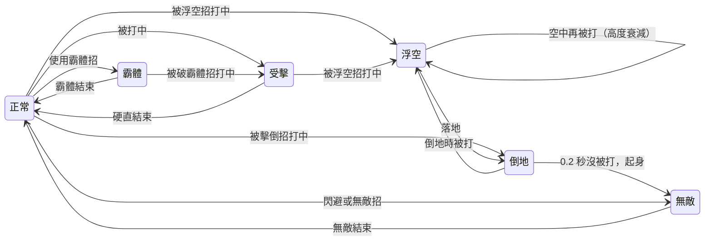
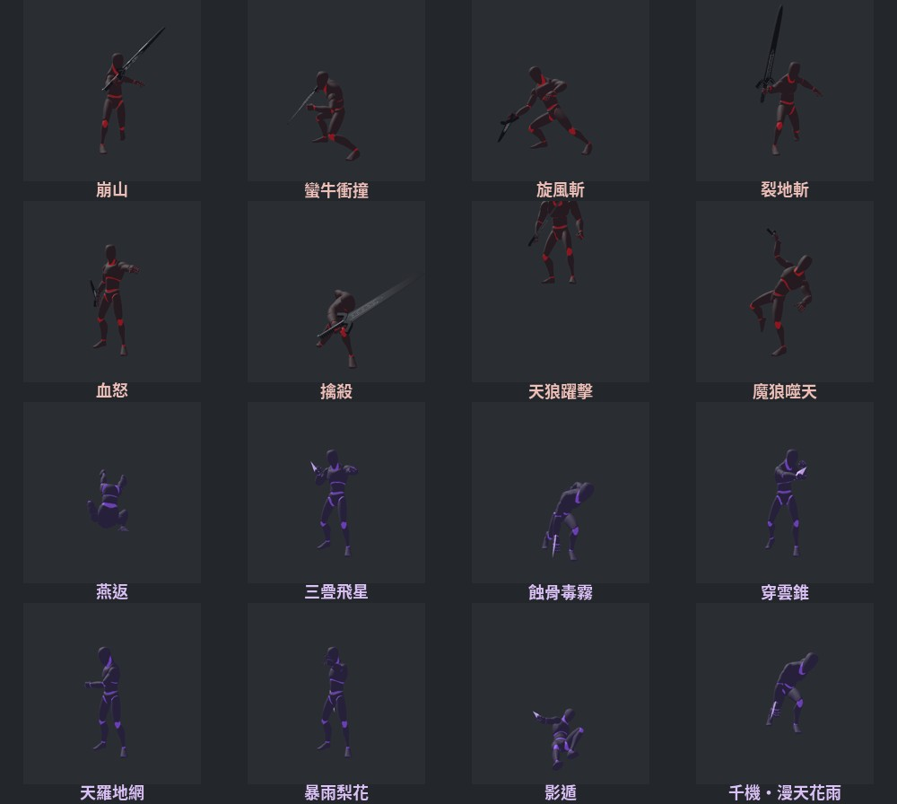

# 《天魔劫》戰鬥設計文件

第三人稱動作遊戲《天魔劫》的戰鬥規則。狀態體系參考《疾風之刃》的霸體、無敵與浮空連段，再依自己的需求調整。
目前有三個角色、33 招、73 段判定，可以單人闖關、區網雙人合作，以及區網 1v1 三命單挑。

> 這份文件由 `tools/combat_doc.py` 從遊戲實際使用的資料表產生，文件上的數字就是遊戲裡的數字。

## 目錄

1. [設計目標](#1-設計目標)
2. [六種角色狀態](#2-六種角色狀態)
3. [每一下攻擊的五個屬性](#3-每一下攻擊的五個屬性)
4. [防無限連與防圍毆](#4-防無限連與防圍毆)
5. [霸體攻防](#5-霸體攻防)
6. [三個角色的定位](#6-三個角色的定位)
7. [浮空與連段](#7-浮空與連段)
8. [1v1 單挑與雙人合作](#8-1v1-單挑與雙人合作)
9. [完整招式表](#9-完整招式表)
10. [操作](#10-操作)
11. [附錄：資料與實作](#11-附錄資料與實作)

## 1. 設計目標

- **每一下攻擊都有明確後果。** 打中之後對手會硬直多久、會不會浮空、會不會倒地，都由招式資料決定，玩家可以預期。
- **連段可以很長，但一定會結束。** 浮空高度逐下衰減，起身有無敵，被連的人總有機會回到場上。
- **霸體與破霸體是核心攻防。** 霸體讓角色能硬吃攻擊出招，破霸體招式是它的解法；三個角色擁有的數量不同，形成各自的打法。
- **玩家與敵人同一套規則。** 敵人會被挑空、追打，也能把玩家打出硬直與浮空；同一套規則直接用在玩家對玩家。

## 2. 六種角色狀態

| 狀態 | 能否操控 | 被打到會怎樣 | 怎麼結束 |
|---|---|---|---|
| 正常 | 可以 | 依招式進入受擊、浮空或倒地 | — |
| 受擊 | 不行 | 重新計算硬直；浮空招照樣打浮空 | 硬直時間到，回到正常 |
| 浮空 | 不行 | 再往上彈，每多一下高度 ×0.85 | 落地後進入倒地 |
| 倒地 | 不行 | 重新浮空，至少彈起 1 公尺 | 0.2 秒內沒被打就起身，起身無敵 0.9 秒 |
| 霸體 | 可以 | 照樣受傷並有頓幀，但不會被打斷 | 霸體時間到，或被破霸體招式打中 |
| 無敵 | 可以 | 打不到、不受傷 | 無敵時間到 |

## 3. 每一下攻擊的五個屬性

一招可以有很多段判定，每一段各自設定下面五個屬性。

| 屬性 | 作用 | 設計用途 |
|---|---|---|
| 硬直時間 | 對手被打中後不能操控的秒數 | 決定這一下之後還能不能接下一招 |
| 是否浮空 | 是否把站著的對手打上半空 | 區分連段起手招與一般招式 |
| 浮空高度 | 打上去多高（公尺） | 越高，後面能接的招越多 |
| 是否破霸體 | 能否打斷霸體中的對手 | 霸體的解法，數量少、冷卻長 |
| 是否擊倒 | 是否讓站著的對手直接倒地 | 連段收尾，或製造倒地追打的機會 |

「擊倒」是後來才加的屬性。最初只有浮空，而浮空落地就會起身，沒有任何招式能讓站著的對手進入倒地，倒地追打這條規則用不到，所以補上擊倒。

## 4. 防無限連與防圍毆

| 規則 | 數值 | 目的 |
|---|---|---|
| 浮空高度衰減 | 每多打一下 ×0.85 | 連段越長越難接，自然結束 |
| 浮空最低高度 | 低於 0.15 公尺就不再彈起 | 給連段一個硬性終點 |
| 空中被一般招式打到 | 只小彈 0.6 公尺 | 不帶浮空的招式也能續連，但效率較差 |
| 起身無敵 | 0.9 秒 | 倒地的人起身時不會被壓制到死 |
| 受擊保護 | 從受擊恢復後 0.6 秒內再被打，只受傷、不硬直 | 玩家被一群敵人圍住時仍然能動 |
| 閃避 | 無敵 0.3 秒，冷卻 0.9 秒 | 每個角色都有的基本脫身手段 |

## 5. 霸體攻防

- 玩家的霸體來自招式：招式資料標明霸體從第幾秒開始、到第幾秒結束。
- 精英與首領常駐霸體。被破霸體招式打中後有 2.5 秒空窗，這段時間可以打出硬直、浮空與倒地。
- 精英的硬直時間 ×0.7、首領 ×0.4，即使破了霸體，也不能像小怪一樣連到底。
- 大招全程無敵並帶破霸體，靠怒氣施放：命中 +2.5、受擊 +4，集滿 100。

## 6. 三個角色的定位

| | 南宮逸（太刀） | 韓天狼（巨劍） | 唐七（柳葉飛刀） |
|---|---|---|---|
| 定位 | 連段型 | 霸體重擊型 | 遠程控場型 |
| 普攻段數 | 4 | 3 | 2 |
| 自帶霸體的招式 | 1 | 8 | 0 |
| 自帶無敵的招式 | 3 | 1 | 3 |
| 破霸體的招式 | 2 | 3 | 2 |
| 能浮空的招式 | 5 | 3 | 3 |
| 能擊倒的招式 | 2 | 4 | 1 |
| 打法 | 用挑月或普攻第三段起手，把對手留在空中打完整連段；危險時靠無敵招閃開。 | 頂著霸體硬換招，用破霸體招式拆掉對手的霸體，再用擊倒與範圍浮空收割。 | 保持距離，用毒霧與絲網限制走位；被貼身時用燕返踢開並後撤。 |
| 弱點 | 破霸體手段只有拔刀・一閃與大招，遇到霸體對手要等冷卻。 | 出招慢、除了大招沒有無敵招式，打不到人時容易被繞背或風箏。 | 沒有霸體，被近身後只有燕返與影遁兩招能脫身。 |

招式數量含普攻與大招。

## 7. 浮空與連段

浮空有三個來源：

1. **起手招**：把站著的對手打上半空。浮空高度決定後面能接幾下。
2. **托空招**：對手已經在空中時把它托住。任何攻擊打到浮空的對手都會讓它再彈起 0.6 公尺；帶浮空屬性的招式用自己的高度。
3. **倒地追打**：對手倒地時被任何攻擊打到，都會彈起至少 1 公尺，可以重新起連段。

霸體中的對手不會被打浮空。

| 角色 | 招式 | 按鍵 | 浮空高度 | 類型 | 用途 |
|---|---|---|---|---|---|
| 南宮逸 | 上撩 | 左鍵（第 3 段） | 1 m | 起手 | 普攻連段中自然把敵人帶離地面，第四段接著打 |
| 南宮逸 | 挑月 | 右鍵 | 2.2 m | 起手 | 主要起手，最高，後面可接完整連段 |
| 南宮逸 | 追風連斬 | E | 0.5 m×5 | 托空 | 空中托住：五下每下都把敵人往上帶，連段中段用 |
| 南宮逸 | 殘影 | 2 | 1.5 m | 起手 | 反擊成功時挑空，反守為攻 |
| 南宮逸 | 天劍・萬象歸一 | V | 0.8 m×8 | 托空 | 八連斬一路把敵人帶上去，最後一劍劈落倒地 |
| 韓天狼 | 崩山 | 右鍵 | 1.8 m | 起手 | 範圍起手：把周圍一圈敵人全部震起 |
| 韓天狼 | 天狼躍擊 | 3 | 2.5 m | 起手 | 最高的範圍起手，落點周圍都浮空 |
| 韓天狼 | 魔狼噬天 | V | 1.4 m×3 | 起手 | 三記橫掃捲上半空，最後一擊劈落倒地 |
| 唐七 | 燕返 | 右鍵 | 1.2 m | 起手 | 近身自保：踢飛貼臉的敵人並後撤 |
| 唐七 | 暴雨梨花 | 2 | 0.4 m×8 | 托空 | 針雨把浮空的敵人釘在半空，遠距離續連 |
| 唐七 | 千機・漫天花雨 | V | 0.5 m×12 | 托空 | 十二輪針雨托空，爆裂暗器炸落倒地 |

**連段範例（南宮逸）**

1. 左鍵 ×3：第三段上撩把對手帶離地面。
2. 左鍵第四段：縱劈追打。
3. 右鍵挑月：重新挑高。
4. E 追風連斬：五下托空。
5. 左鍵追打，落地前用 R 落雁斬收尾。

對手倒地後再補一刀會重新彈起，可以再接挑月；但浮空高度已經衰減，能接的招數比第一輪少。

敵人打玩家：一般近戰與飛行道具只造成硬直；地上有預警圈的範圍攻擊會把玩家打浮空 1.4 公尺。

## 8. 1v1 單挑與雙人合作

**問劍坪單挑（1v1）**

| 項目 | 規則 |
|---|---|
| 勝負 | 每人 3 條命，先讓對手用完的一方獲勝 |
| 氣血 | 每條命 10000 |
| 每命結束 | 雙方回到出生點，氣血、怒氣、技能冷卻與場上暗器全部重置 |
| 同時倒下 | 最後一命同時倒下時進入加賽 |
| 開戰 | 倒數 3 秒 |
| 場地 | 26 公尺見方，開局間距 12 公尺 |

每命重置冷卻與怒氣，是為了讓每一命都從相同條件開始，上一命的優勢不會滾到下一命。

**雙人合作**

兩人共闖原本的四張地圖。武學與成長各自計算；倒下時觀戰，隊友清完當前區域後復起，兩人都倒下才結算。

**連線方式**

區域網路連線。戰鬥判定由房主執行，房主每秒送出 20 次狀態；另一方先在本機預測自己的移動與出招，再依房主的結果校正，自己的操作會立即有反應。

## 9. 完整招式表

傷害是基礎攻擊力的百分比。「自身狀態」是出招者在招式第幾秒到第幾秒帶有霸體或無敵。

### 南宮逸（太刀）：連段型

快、連段長、擅長把敵人挑空追打；靠無敵招閃避，破霸體手段少（拔刀・一閃、大招）。

| 按鍵 | 招式 | 冷卻 | 自身狀態 | 段數×傷害 | 硬直 | 浮空 | 破霸體 | 擊倒 | 說明 |
|---|---|---|---|---|---|---|---|---|---|
| 左鍵（第 1 段） | 斜斬 | — |  | 1×60% | 0.3 秒 | — |  |  | 普攻第一段 |
| 左鍵（第 2 段） | 橫斬 | — |  | 1×65% | 0.3 秒 | — |  |  | 普攻第二段 |
| 左鍵（第 3 段） | 上撩 | — |  | 1×75% | 0.35 秒 | 1 m |  |  | 普攻第三段，把敵人撩離地面（小浮空） |
| 左鍵（第 4 段） | 縱劈 | — |  | 1×110% | 0.5 秒 | — |  |  | 普攻收尾：打中浮空的敵人會再托高一點並劈退 |
| 右鍵 | 挑月 | 4 秒 |  | 1×120% | 0.4 秒 | 2.2 m |  |  | 由下往上挑斬，把敵人挑上半空，連段起手 |
| Q | 疾風步 | 6 秒 | 無敵 0.05–0.3 秒 | 1×140% | 0.4 秒 | — |  |  | 向前突進穿過敵人並斬擊，突進途中無敵 |
| E | 追風連斬 | 8 秒 |  | 5×35% | 0.25 秒 | 0.5 m |  |  | 五連快斬，每一下都能把浮空的敵人托住 |
| R | 落雁斬 | 8 秒 |  | 1×160% | 0.5 秒 | — |  | ✓ | 躍起下劈，把站著的敵人劈倒在地；倒地後再打就會浮空，可以接挑月重新起連段 |
| 1 | 拔刀・一閃 | 12 秒 | 霸體 0–0.55 秒 | 1×220% | 0.7 秒 | — | ✓ |  | 收刀蓄勢後一閃而過，蓄勢期間霸體，破除霸體 |
| 2 | 殘影 | 14 秒 | 無敵 0–0.4 秒 | 1×180% | 0.5 秒 | 1.5 m |  |  | 架勢 0.4 秒無敵；期間被攻擊就閃到敵人身後反斬並挑空 |
| 3 | 劍氣縱橫 | 10 秒 |  | 3×70% | 0.25 秒 | — |  |  | 連揮三道劍氣，遠距離牽制 |
| V | 天劍・萬象歸一 | 怒氣滿 | 無敵 0–2.4 秒 | 8×60%＋1×400% | 0.3～0.8 秒 | 0.8 m | ✓ | ✓ | 全程無敵。化作殘影連斬八次把敵人帶上空中，最後一劍劈落 |

### 韓天狼（巨劍）：霸體重擊型

慢、每一下都重、出招大多帶霸體可以硬換；破霸體手段最多（衝撞、擒殺、大招）。

| 按鍵 | 招式 | 冷卻 | 自身狀態 | 段數×傷害 | 硬直 | 浮空 | 破霸體 | 擊倒 | 說明 |
|---|---|---|---|---|---|---|---|---|---|
| 左鍵（第 1 段） | 橫掃 | — |  | 1×90% | 0.4 秒 | — |  |  | 普攻第一段 |
| 左鍵（第 2 段） | 回斬 | — | 霸體 0.1–0.45 秒 | 1×100% | 0.45 秒 | — |  |  | 普攻第二段，出招中霸體 |
| 左鍵（第 3 段） | 重劈 | — | 霸體 0.1–0.6 秒 | 1×150% | 0.6 秒 | — |  | ✓ | 普攻收尾，出招中霸體，把敵人劈倒 |
| 右鍵 | 崩山 | 6 秒 | 霸體 0–0.5 秒 | 1×150% | 0.5 秒 | 1.8 m |  |  | 巨劍砸地，震起周圍所有敵人 |
| Q | 蠻牛衝撞 | 8 秒 | 霸體 0–0.7 秒 | 1×130% | 0.6 秒 | — | ✓ |  | 壓肩突進，途中橫揮巨劍，撞開敵人並破除霸體 |
| E | 旋風斬 | 9 秒 | 霸體 0–1.1 秒 | 4×55% | 0.3 秒 | — |  |  | 持劍旋轉四圈，全程霸體 |
| R | 裂地斬 | 10 秒 |  | 1×170% | 0.5 秒 | — |  | ✓ | 劈出一道直線衝擊波，掃倒路徑上的敵人 |
| 1 | 血怒 | 20 秒 | 霸體 0–6 秒 | — | — | — |  |  | 消耗一成生命，六秒內霸體且傷害提高兩成 |
| 2 | 擒殺 | 12 秒 | 霸體 0–0.8 秒 | 1×60%＋1×140% | 0.6 秒 | — | ✓ | ✓ | 抓住面前的敵人舉起再砸下，破除霸體 |
| 3 | 天狼躍擊 | 12 秒 | 霸體 0.2–0.8 秒 | 1×190% | 0.6 秒 | 2.5 m |  |  | 高高躍起砸向目標，落點周圍的敵人被震上半空 |
| V | 魔狼噬天 | 怒氣滿 | 無敵 0–2.6 秒 | 3×180%＋1×500% | 0.5～0.9 秒 | 1.4 m | ✓ | ✓ | 全程無敵。三記巨劍橫掃把敵人捲上空中，最後一擊劈裂地面 |

### 唐七（柳葉飛刀）：遠程控場型

遠程、靠陷阱與毒霧控場、近身用燕返脫離；破霸體靠穿雲錐與大招。

| 按鍵 | 招式 | 冷卻 | 自身狀態 | 段數×傷害 | 硬直 | 浮空 | 破霸體 | 擊倒 | 說明 |
|---|---|---|---|---|---|---|---|---|---|
| 左鍵（第 1 段） | 拂葉 | — |  | 1×50% | 0.2 秒 | — |  |  | 抖腕擲出一柄柳葉飛刀 |
| 左鍵（第 2 段） | 回身飛刃 | — |  | 1×130% | 0.45 秒 | — |  |  | 接第二段時轉肩蓄勢，反手擲出重刃 |
| 右鍵 | 燕返 | 5 秒 | 無敵 0.15–0.5 秒 | 1×70% | 0.35 秒 | 1.2 m |  |  | 一腳把近身的敵人踢上半空，自己後空翻拉開距離，翻身途中無敵 |
| Q | 三疊飛星 | 5 秒 |  | 3×60% | 0.25 秒 | — |  |  | 連續三次彈指發針 |
| E | 蝕骨毒霧 | 10 秒 |  | 1×25% | 0 秒 | — |  |  | 擲出毒囊，落處留下五秒毒霧 |
| R | 穿雲錐 | 10 秒 |  | 1×200% | 0.6 秒 | — | ✓ |  | 沉肩蓄勢，飛錐貫穿一線敵人並破除霸體 |
| 1 | 天羅地網 | 14 秒 |  | 1×40% | 1.2 秒 | — |  |  | 埋下絲網機關，十二秒內有敵人靠近就收網定身 |
| 2 | 暴雨梨花 | 12 秒 |  | 8×30% | 0.2 秒 | 0.4 m |  |  | 揚手撒針，針雨落在目標區域並托住浮空敵人 |
| 3 | 影遁 | 12 秒 | 無敵 0–0.6 秒 | — | — | — |  |  | 化作殘影向前衝刺，下一枚投出的暗器必定暴擊 |
| V | 千機・漫天花雨 | 怒氣滿 | 無敵 0–2.5 秒 | 12×50%＋1×350% | 0.25～0.8 秒 | 0.5 m | ✓ | ✓ | 躍起揮灑十二輪飛針托空，最後以爆裂暗器擊倒敵人 |

## 10. 操作

| 按鍵 | 功能 |
|---|---|
| WASD／滑鼠 | 移動／轉動鏡頭（越肩第三人稱） |
| 左鍵 | 普攻（連按接下一段） |
| 右鍵、Q、E、R、1、2、3 | 技能一～七 |
| V | 大招 |
| Shift | 閃避（短暫無敵） |
| 空白鍵 | 跳 |
| F | 互動（參悟、鐵匠、商人） |
| K | 經脈 |

每個角色固定一把兵器，技能開局全部可用，只受冷卻限制。

## 11. 附錄：資料與實作

| 內容 | 位置 |
|---|---|
| 招式（動作、時間、位移、冷卻、自身狀態） | `data/moves.csv` |
| 每一段判定的五個屬性與傷害 | `data/move_hits.csv` |
| 狀態相關數值（衰減、無敵時間、空窗、擂台規則） | `data/combat_state_config.csv` |
| 六種狀態的邏輯（玩家與敵人共用） | `scripts/combat_state.gd` |
| 招式執行（連段、輸入緩衝、冷卻、怒氣） | `scripts/move_runner.gd` |
| 區網連線 | `scripts/lan_session.gd` |
| 自動化測試 | `tests/smoke_test.gd`、`tests/lan_integration.gd` |

改完資料表後執行 `python3 tools/combat_doc.py` 重新產生這份文件。

**尚未完成**

- 敵人各招式個別設定五個屬性（目前依階級與攻擊種類給預設值）。
- 鎖定目標。
- 數值為初版，尚未做完整的對戰平衡。

**素材來源**

- 角色模型與基礎動作：Quaternius Universal Animation Library 1、2（CC0）。
- 動作預覽工具：[MotionStage](https://github.com/jbang2004/motion-stage)（MIT）。
